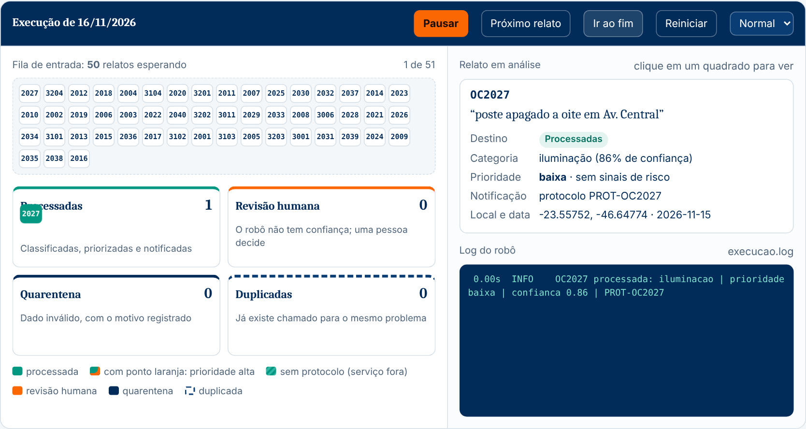
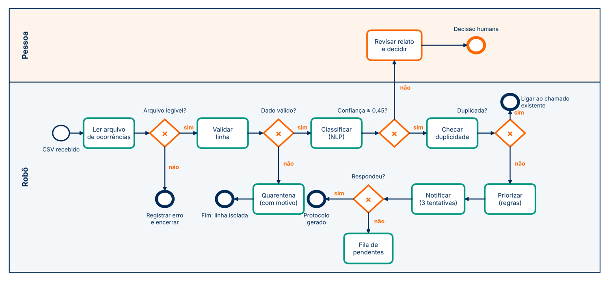
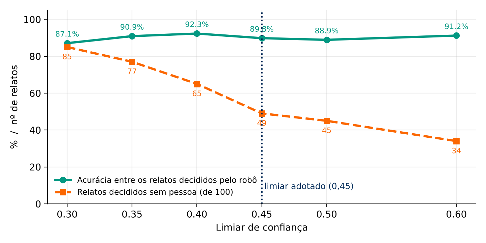

# InovaCity · Robô de triagem de ocorrências urbanas

> Conectando pessoas. Transformando cidades.

Robô de RPA com IA que lê os relatos dos moradores sobre problemas do bairro (buraco, poste apagado, lixo e entulho, alagamento, calçada sem acessibilidade), decide o destino de cada um e deixa para uma pessoa só o que não consegue resolver com segurança.

Projeto do grupo InovaCity, **FIAP · Global Solution 2026.2 – CitizenTech**, disciplina *AI for Robotic Process Automation*.

**Integrantes:** Rodrigo Wolkoff Giorgi (RM 556980) · Carlos Eduardo Mamede (RM 568269)



## O que o robô faz

Em uma execução, sem intervenção, cada linha do CSV passa por seis etapas:

1. **Leitura** do arquivo de ocorrências (arquivo ausente ou ilegível não derruba a execução).
2. **Validação**: linha inválida vai para a quarentena, com o motivo.
3. **Classificação** do texto (TF-IDF + regressão logística), com uma confiança. Abaixo de 0,45, o relato vai para **revisão humana**.
4. **Duplicidade**: mesma categoria, até 150 m de distância e texto parecido (Jaccard ≥ 0,6). Duplicata não abre novo chamado.
5. **Prioridade** por regras transparentes (categoria + sinais de risco no texto).
6. **Notificação** a um serviço externo simulado, com 3 tentativas e espera crescente. Se falhar, o item vai para a fila de pendentes.



## Resultado em números

Todos os dados são sintéticos. O conjunto de teste usa frases diferentes das de treino, de propósito.

| Medida | Resultado |
|---|---|
| Acurácia no teste (100 relatos) | 80% |
| Relatos decididos sem pessoa (confiança ≥ 0,45) | 49 de 100, com 89,8% de acerto |
| Lote de entrada | 51 linhas: 32 processadas, 12 em revisão humana, 4 em quarentena, 3 duplicadas |
| Notificações | 30 enviadas, 2 pendentes após 3 tentativas (30% de falha simulada) |
| Testes automatizados | 9, todos aprovados |

O desempenho em relatos reais não foi medido. Detalhes, erros e limitações estão no relatório.



## Como rodar

Python 3.10 ou mais novo. A única dependência é o scikit-learn.

```powershell
cd codigo
pip install -r requirements.txt
python main.py                     # roda o robô e abre a tela de login no navegador
```

Outros comandos, também dentro de `codigo`:

```powershell
python avaliar.py                  # acurácia no conjunto de teste
python -m unittest tests.test_rpa  # testes automatizados
python main.py --entrada nao_existe.csv --saida saida/demo_entrada_ausente
python main.py --saida saida/demo_servico_fora --simular-servico-fora
```

Ao terminar, o robô grava as filas (CSV), o relatório (JSON) e o log em `saida/`, regera o site e abre sozinho no navegador a **tela de login**; depois de entrar, aparecem os resultados (`--sem-site` desliga isso).

No Windows, o jeito mais simples é dar dois cliques em **`codigo/executar_robo.bat`**: ele apaga a `saida/`, roda o robô (execução normal, demonstrações de falha e segunda execução), mede o classificador, roda os testes e abre a tela de login e, depois de entrar, os resultados dessa execução.

## Site

- **`site/index.html`**: apresentação do robô a partir das saídas reais. Reproduz a execução relato a relato, mostra as filas, a medição, as falhas tratadas e o mapa do barema. Tem a seção **Teste com seu arquivo**: escolha um CSV (`id,texto,lat,lon,data`) e veja a triagem com uma interpretação. Há dois exemplos em `codigo/dados/`.
- **`site/landing.html`**: tela de login da InovaCity (cadastro por nome e senha). É a primeira página que o robô abre; depois de entrar, leva ao `index.html`.

Os dois abrem com duplo clique, sem internet. O `index.html` da pasta `site/` mostra a execução dos autores; o `codigo/site/index.html` é regerado pelo robô com a sua execução.

## Temas da disciplina

| Tema | Função no robô |
|---|---|
| Hiperautomação | Orquestra RPA, IA, regras e revisão humana no mesmo fluxo |
| Processos, tarefas e BPM/BPMN | Processo desenhado antes do código; um módulo por tarefa |
| RPA com arquivos | Entrada e saída por CSV, JSON e log |
| RPA com IA: tarefas inteligentes | Classificação, prioridade e duplicidade |

## Conteúdo do repositório

| Caminho | O que é |
|---|---|
| `codigo/` | Robô em Python, dados sintéticos, testes, evidências da execução e figuras |
| `site/` | Site de apresentação e landing page |
| `Relatorio_RPA_InovaCity.pdf` | Relatório em formato ABNT |
| `LEIA-ME.txt` | Orientações de abertura |

## Ética e dados

Nenhum dado pessoal real é usado. O robô não decide sozinho quando está incerto. O principal risco é o viés territorial: bairros que mais relatam seriam atendidos primeiro. Contribui para os ODS 9, 10 e 11.